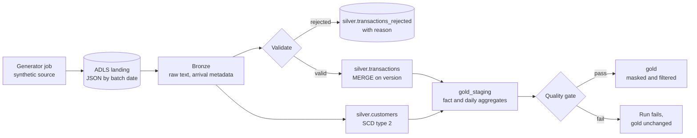

# Card payments lakehouse

A bronze, silver and gold lakehouse for synthetic card payments, built for Azure Databricks with Terraform and a Databricks bundle. The target run is 120 million transactions over 30 days, with late data, duplicates, reversals, customer changes, PII masking and a quality gate before anything is published.

## Status

| Phase | What it covers | State |
| --- | --- | --- |
| 1. Build | Generator, pipeline, storage contract, tests, Terraform, bundle, CI | Done. 19 tests pass locally |
| 2. Deploy | `terraform apply`, bundle deploy, 120M-row run, masks and row filters verified, cost report | Needs an Azure subscription |
| 3. Tune | Skew fix measured in the Spark UI, liquid clustering, maintenance results | After Phase 2 |

What has and has not been verified:

- **Verified locally:** the pipeline logic and the local storage backend, with 19 tests and Spark 4.0. One mutation check confirmed the SCD2 replay test fails when its guard is removed.
- **Verified in CI only:** the Delta Lake backend and Terraform validation. Both need downloads that this project's development environment could not reach, so they run in GitHub Actions.
- **Not yet verified:** anything on Azure. The Terraform, bundle and governance SQL have not been applied to a real workspace.

## The data

The source is invented, so no real person appears in it. It is generated from hashes rather than a random generator, so the same settings produce identical files on any cluster size.

| Defect | Rate | What it tests |
| --- | --- | --- |
| Resent duplicate transactions | 0.5% | Deduplication |
| Events arriving 1 to 3 days late | 2% | Reprocessing past event dates |
| Reversals, sent as version 2 | 1% of approvals | Merge on a version number |
| Malformed amounts | 0.1% | Quarantine with a reason |
| Customer state or segment changes | 0.4% a day | SCD type 2 history |
| Merchant popularity skew | Top merchant over 5% of traffic | Join skew and tuning |

PII-like fields are safe by construction. SSNs use the 900 to 999 area range, which is never issued, and emails use the reserved `example.com` domain.

## Architecture



Each batch date reprocesses only the event dates it touched, so a late transaction updates its own day's figures without a full rebuild.

## Design decisions

| Decision | Why | Rejected alternative |
| --- | --- | --- |
| One storage contract with Delta and local backends | The pipeline runs on a laptop with no Delta jars, and the same contract tests run against both backends in CI, so the stand-in cannot drift | Mocking Delta, which tests nothing real |
| Bronze stores every field as text | A bad value is kept and reported instead of failing the read | Typed bronze, which loses records when the source changes |
| MERGE only when the incoming version is higher | Replays and resent duplicates change nothing | Last write wins, which lets an old resend overwrite a reversal |
| SCD2 changes must be newer than the open version | Replaying an older batch cannot reopen history | Comparing attributes alone, which records false changes on replay |
| Point-in-time join to the customer dimension | A transaction carries the customer's state when it happened | A join to the current row, which rewrites history |
| Write, audit, publish through `gold_staging` | Analysts never see a batch that failed its checks | Writing gold directly and checking afterwards |
| Managed identity through an access connector | No secret is stored or rotated anywhere | A service principal with a client secret |
| Two Terraform root modules | The Databricks provider needs the workspace to exist before it can configure it | One module with brittle provider dependencies |
| Job cluster policy with spot workers | Caps cost on every job, whoever defines it | Trusting each job definition |

## Quality gate

A batch fails, and gold stays unchanged, if any of these checks fail:

- More than 2% of the batch's transactions are rejected
- A transaction appears twice in the fact table
- A fact row has no customer version
- A merchant appears twice on one day
- Daily net sales differ from silver by even one cent
- A customer has more or fewer than one open version, or two versions overlap

## Testing

| Suite | Runs | What it proves |
| --- | --- | --- |
| `test_generate.py` | Locally and in CI | The source is deterministic, defects arrive at their configured rates, traffic is skewed, PII cannot be real |
| `test_layers.py` | Locally and in CI | Each defect is rejected with its reason, currency converts correctly, the newest version wins, point-in-time joins choose the right customer version |
| `test_tables_contract.py` | Both backends in CI | Partition replacement, version-guarded upserts, SCD2 closing, and SCD2 replays behave the same on Delta and locally |
| `test_pipeline.py` | Both backends in CI | Rerunning any day leaves every table identical, gold has one row per transaction, a bad batch never reaches gold |
| `test_governance_sql.py` | Locally and in CI | The masking SQL splits cleanly and refuses unsafe catalog names |

## Cost

Phase 2 will measure real spend. Until then, a rough estimate: a job cluster with a driver and 2 workers costs about $1 to $3 an hour on Azure, depending on region, spot pricing and the Databricks tier. Third-party guides put Jobs Compute at about $0.15 per DBU, but rates change, so check the [Azure Databricks pricing page](https://azure.microsoft.com/pricing/details/databricks/) before relying on it ([example breakdown](https://www.lucentinnovation.com/resources/it-insights/azure-databricks-pricing)). The full Phase 2 run should take a few cluster-hours.

Guardrails that keep it low:

- A $50 monthly budget, alerting at 50%, at 90%, and at 100% forecast. Azure budgets alert but never stop resources.
- A cluster policy that allows only job clusters, up to 4 workers, with spot capacity.
- Job clusters end with their job, so nothing idles.
- `terraform destroy` removes everything.

## How to run it

### Locally

You need [uv](https://docs.astral.sh/uv/) and Java 17 or later. Spark runs best under WSL2 on Windows.

```bash
uv sync --extra local
uv run pytest                                # about 2.5 minutes
uv run lakehouse local-demo --days 4         # 4 days, about 80,000 transactions
```

### On Azure

You need an Azure subscription where you are Owner, the [Azure CLI](https://learn.microsoft.com/cli/azure/install-azure-cli), [Terraform](https://developer.hashicorp.com/terraform/install), the [Databricks CLI](https://docs.databricks.com/dev-tools/cli/install.html), and account admin rights in the Databricks account.

1. **Create the Azure resources.**
   ```bash
   az login
   cd infra/azure
   terraform init
   terraform apply -var alert_email=you@example.com
   ```
2. **Create two account-level groups** in the Databricks account console: `payments_engineers` and `payments_analysts`. Add yourself to the first. Create `pii_readers` and add the identity that runs the jobs.
3. **Configure Unity Catalog.** Copy the four outputs from step 1 into `infra/databricks/terraform.tfvars`, then run `terraform init && terraform apply` there.
4. **Deploy and run the jobs.**
   ```bash
   databricks bundle deploy -t dev --var landing_root=<landing_url> --var cluster_policy_id=<policy id>
   databricks bundle run generate_source -t dev
   databricks bundle run daily_batch -t dev --params batch_date=2026-01-01
   ```
   Run batch dates in order. Then run the `governance` job once.
5. **Tear it down** with `terraform destroy` in `infra/databricks`, then in `infra/azure`.

## Known gaps to close in Phase 2

- Writes into a table with a row filter must be confirmed on the target runtime. If `replaceWhere` is refused, the gold publish step will switch to `MERGE`.
- The job identity must belong to `pii_readers`. Otherwise the SCD2 merge reads masked values and records a false change for every customer.
- `_landing_exists` uses the JVM file system, which works on dedicated job clusters but not on serverless compute.
- The cost section above is an estimate, not a measurement.
